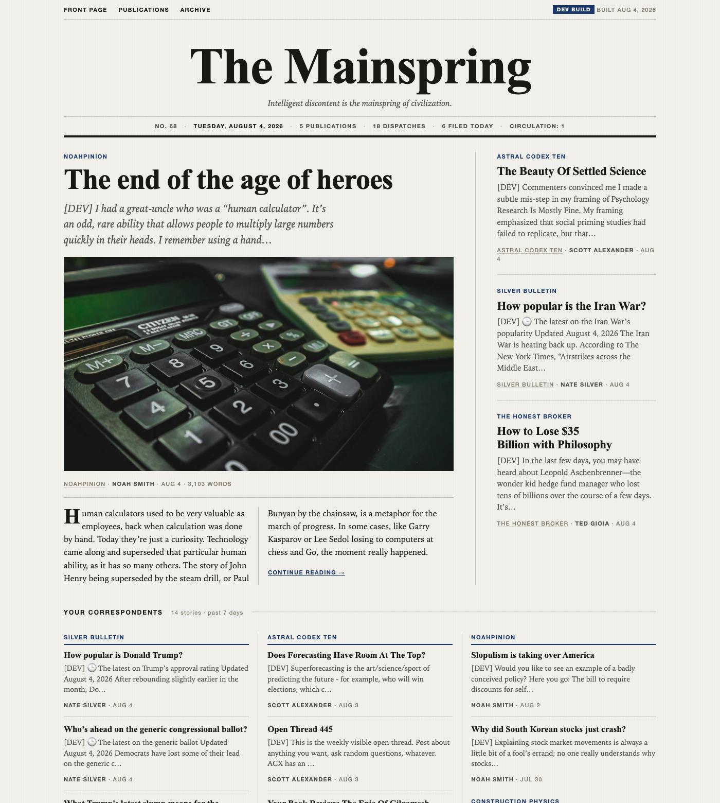

# Mainspring

> *"Intelligent discontent is the mainspring of civilization."* — Eugene V. Debs

A self-hosted, privacy-first reader that turns every Substack you subscribe to
into a newspaper. Feeds go in; a front page comes out — lead story, secondaries,
a multi-column river of everything else, with per-publication pages and a dated
archive. Summaries are written by a model running on your own machine.
**No API keys, no cloud services, no accounts, nothing leaving your hardware.**

The output is a folder of plain HTML files. Open it, host it, or push it to
GitHub Pages.

---

## Why self-host?

**What you read is nobody else's business.** Commercial readers and AI summary
tools send your subscription list, your reading history, and the text of what you
read to servers you do not control. Mainspring does none of that:

- **No API keys.** Summarization runs locally on DistilBART. No OpenAI, no
  Anthropic, no Google.
- **No data egress.** Posts are fetched from the publications you already
  subscribe to and stored in a local SQLite file. Nothing is uploaded.
- **No tracking.** No accounts, no analytics, no telemetry, no cookies. Not a
  single line of JavaScript in the generated site.
- **No third-party fonts.** The stylesheet uses fonts already on your machine,
  because a page that fetches its typography from a CDN is not a private page.
- **Complete data sovereignty.** One `news.db` file and one `site/` folder, both
  yours.
- **Audit everything.** It is a few thousand lines of Python, Jinja, and one
  hand-written stylesheet. Read it in an afternoon.

One honest caveat, spelled out rather than buried: article bodies reference
images on Substack's CDN, so viewing a page still makes a request to that CDN.
Every page sends `no-referrer`, so no URL or referrer is disclosed — but the
request happens. Mirroring images locally is on the roadmap.

---

## Setup

### Prerequisites

- Python 3.11+
- ~2 GB free disk space for the model, downloaded once and cached. Not needed in
  dev mode.
- A CPU is fine. A GPU makes summarization much faster.

### 1. Clone and create a virtual environment

```bash
git clone https://github.com/daltonoscar0/mainspring.git
cd mainspring
python3 -m venv .venv
source .venv/bin/activate        # Windows: .venv\Scripts\activate
```

### 2. Install

```bash
pip install -r requirements.txt
```

> **On PyTorch.** `torch` is ~700 MB and only needed for real summarization. For
> a CPU-only wheel:
> ```bash
> pip install torch --index-url https://download.pytorch.org/whl/cpu
> pip install -r requirements.txt
> ```
> To skip it entirely, install everything above `transformers` in
> `requirements.txt` and run in dev mode.

### 3. List what you read

```bash
cp subscriptions.example.yaml subscriptions.yaml
```

Then edit it. `subscriptions.yaml` is gitignored — what you read is exactly the
sort of thing this project exists to keep to yourself — and if you skip this step
Mainspring falls back to the example list, so a fresh clone still builds a real
edition on the first run.

```yaml
publications:
  - name: Construction Physics
    slug: construction-physics
    feed_url: https://www.construction-physics.com/feed
    tier: free
```

For any Substack the feed is the site plus `/feed` — that works for custom
domains (`https://www.example.com/feed`) as well as
`https://example.substack.com/feed`. Non-Substack feeds work too.

| Field | Meaning |
|---|---|
| `name` | Display name, used in bylines and standing heads |
| `slug` | URL-safe id; becomes `publications/<slug>.html`, so pick it once |
| `feed_url` | RSS endpoint |
| `tier` | `free` (over RSS, works today) or `paid` (over email — see the roadmap) |
| `kind` | `newsletter` (default) or `wire`; decides which river it files into |
| `fetch_pages` | `false` to never fetch the post page, even for an excerpt feed |
| `homepage_url` | Optional; defaults to `feed_url` with `/feed` removed |

`kind` matters once you mix a news outlet in with newsletters: pooled into one
river and ordered by recency, an outlet that posts hourly takes every slot and a
newsletter from three days ago never appears. The front page carries a separate
river for each, with its own reserved slots.

`fetch_pages: false` is for a publisher whose feed is clean but whose article
pages defeat the cleaner — Democracy Now wraps its transcripts in sidebars of
guests, topics and links — or simply one you would rather not crawl.

**Check publications before you add them.** A Substack can look healthy in a
browser and still produce nothing here — the domain may belong to something else,
the publication may have moved and left a stale feed behind, or its posts may be
paid and arrive as teasers. This checks all three and prints YAML you can paste:

```bash
python scripts/check_feeds.py https://www.astralcodexten.com/feed
python scripts/check_feeds.py construction-physics.com maxread   # domain or handle
python scripts/check_feeds.py --from-file my-substacks.txt        # one per line
python scripts/check_feeds.py --configured                        # re-check what you have
```

It exits nonzero if anything won't work as a free publication, so it also serves
as a periodic health check on a list you already have.

### 4. Build an edition

```bash
python scripts/build_edition.py
```

That ingests every free publication, writes a standfirst for each new post, and
renders the site into `site/`. Open `site/index.html`.

**First-run timeline:** model download 5–15 minutes (once, cached in
`~/.cache/huggingface/`); feed ingest a few seconds; summarizing ~100 posts
20–60 minutes on CPU, 2–5 minutes on GPU. Use `--limit N` to cap the first run.

### 5. Serve it (optional)

The site is static and needs no server. Run one if you want the API, the refresh
endpoints, or the scheduler:

```bash
uvicorn mainspring.app:app --host 127.0.0.1 --port 8000
```

Then open **http://localhost:8000**.

---

## Dev mode

Skip the model entirely and get instant placeholder standfirsts:

```bash
DEV_MODE=1 python scripts/build_edition.py
DEV_MODE=1 uvicorn mainspring.app:app
```

In dev mode `transformers` and `torch` are never imported — nothing is
downloaded, and no GPU is needed. Each post gets a `[DEV] …` dek from its first
30 words, and a **Dev build** badge appears on every page so a placeholder is
never mistaken for real output. The test suite runs in dev mode by design.

---

## Project structure

```
mainspring/
├── mainspring/
│   ├── config.py            # subscriptions loading, env vars, paths
│   ├── models.py            # Publication, Article, DailyEdition
│   ├── database.py          # engine, session factory, init_db()
│   ├── ingest/
│   │   ├── rss.py           # free publications, over RSS
│   │   ├── email_imap.py    # paid publications, over IMAP (Milestone 2)
│   │   └── substack_html.py # the shared Substack HTML cleaner
│   ├── summarize.py         # DistilBART standfirsts + dev-mode shim
│   ├── sitegen/
│   │   ├── rank.py          # headline hierarchy — a pure function
│   │   └── build.py         # renders the whole site into site/
│   ├── templates/           # Jinja2
│   ├── static/              # one hand-written stylesheet, no build step
│   └── app.py               # FastAPI: serves site/ + JSON API
├── subscriptions.yaml        # what you read
├── scripts/build_edition.py  # ingest → summarize → build. The cron entry point.
├── tests/                    # pytest; runs offline, with no model
├── DECISIONS.md              # every judgment call, with the reasoning
└── requirements.txt
```

---

## How it works

### The pipeline

```
subscriptions.yaml
       │
       ▼  feedparser, one request per publication
  RSS feeds  ──────────────────────────────┐
       │                                   │  content:encoded carries the
       ▼  ingest/substack_html.py          │  whole post, so the post URL is
  clean body: chrome out, writing in  ◄────┘  only fetched for a teaser
       │
       ▼  SQLite upsert, deduplicated by URL
  new articles
       │
       ▼  DistilBART, locally, 4 workers
  standfirsts
       │
       ▼  sitegen/rank.py — lead, secondaries, river
  headline hierarchy
       │
       ▼  sitegen/build.py — Jinja2
  site/ — plain HTML, relative links
```

### The HTML cleaner

One module understands Substack's markup, and both ingest paths use it — so an
emailed post and a fetched post produce identical article bodies.

It works from an **allowlist**: only known-good tags survive, everything else is
unwrapped or removed. Out go subscribe widgets, share and comment buttons,
like/restack bars, paywall interstitials, poll and recommendation embeds, email
footers, and tracking pixels. Kept: headings, paragraphs, blockquotes, lists,
images with their `src` and `alt`, captions, links, and tables. Every `class`,
`style` and `on*` attribute is dropped, so a publication cannot inject anything
executable into your site.

Each body comes out twice: sanitized HTML for the page, and plain text for the
summarizer.

### Headline hierarchy

`sitegen/rank.py` is a pure function — no database, no clock — so the same
articles always produce the same page.

- **Lead**: the longest article from whichever publication has gone longest
  without leading. The rotation is the point: six subscriptions should give you
  six voices over a week, not the most prolific one every day. A publication that
  has never led goes first.
- **Secondaries**: the longest remaining stories, preferring one per publication
  so the top of the page is a spread of voices.
- **River**: everything else, newest first, grouped by publication under standing
  heads.

Six Substacks do not file six stories a day, so an **edition** is dated for its
own day but draws on the past week (`EDITION_WINDOW_DAYS`, default 7). The lead
and secondary slots go to that day's new stories wherever there are any; held
stories fill the rest. Set `EDITION_WINDOW_DAYS=1` for strict single-day
editions.

### Standfirsts

The dek under each headline comes from `sshleifer/distilbart-cnn-12-6` — BART
distilled and fine-tuned on news — run on your machine. Beam search with 4 beams,
`no_repeat_ngram_size=3`, 25–90 tokens, input truncated at 1024. Sampling is off,
so a rebuild produces no diff. If generation fails the article's opening
sentences are used instead: a plain lede beats a hole in the page.

---

## Command line

```bash
python scripts/build_edition.py [options]
```

| Option | Effect |
|---|---|
| `--dev` | Same as `DEV_MODE=1`. |
| `--skip-ingest` | Rebuild from what is already stored. No feeds polled. |
| `--skip-summarize` | Do not generate standfirsts. |
| `--offline` | Make no network requests at all. |
| `--limit N` | Generate at most N standfirsts this run. |
| `--site-dir DIR` | Write somewhere other than `site/`. |
| `--quiet` | Warnings and errors only. |

Exit codes: `0` clean, `1` a stage failed, `2` interrupted. An unreachable feed
is reported and sets exit `1`, but the other publications still publish.

---

## API

Only needed if you run the server. The site itself is static.

| Method | Endpoint | Description |
|---|---|---|
| `GET` | `/` | The built site, from `site/` |
| `GET` | `/api/health` | Liveness, dev mode, article and edition counts |
| `GET` | `/api/publications` | Every publication, with article counts |
| `GET` | `/api/articles` | Articles; `?date=`, `?publication=`, `?limit=`, `?offset=`, `?body=` |
| `GET` | `/api/editions` | Every built edition, newest first, with its lead |
| `POST` | `/api/refresh` | Ingest, summarize, rebuild. Backgrounded, returns `202` |
| `POST` | `/api/build` | Rebuild from stored articles. Backgrounded, returns `202` |

```bash
curl http://localhost:8000/api/health
curl "http://localhost:8000/api/articles?publication=construction-physics&limit=5"
curl -X POST http://localhost:8000/api/refresh
```

APScheduler re-ingests every 6 hours (`REFRESH_INTERVAL_HOURS`) and rebuilds
after each ingest.

---

## Environment variables

| Variable | Default | Description |
|---|---|---|
| `DEV_MODE` | unset | `1`/`true`/`yes` skips the model, uses placeholder standfirsts |
| `DB_PATH` | `news.db` | SQLite file location |
| `SITE_DIR` | `site/` | Build output directory |
| `SUBSCRIPTIONS_PATH` | `subscriptions.yaml` | Subscription list location |
| `SITE_NAME` | `The Mainspring` | Masthead text |
| `SITE_TAGLINE` | the Debs line | Strapline under the masthead |
| `EDITION_WINDOW_DAYS` | `7` | Days of wire an edition carries; `1` for strict daily |
| `FRONT_PAGE_LIMIT` | `40` | Maximum stories on one front page |
| `NEWSLETTER_RIVER_LIMIT` | `18` | Slots reserved for the newsletter river |
| `WIRE_RIVER_LIMIT` | `22` | Slots reserved for the wire river |
| `RIVER_PER_PUBLICATION` | `4` | Most river slots any one publication may take |
| `MAX_ENTRIES_PER_FEED` | `25` | Newest entries taken from any one feed per ingest |
| `REFRESH_INTERVAL_HOURS` | `6` | Scheduler interval |
| `REQUEST_TIMEOUT` | `20` | Seconds per HTTP request |
| `MAINSPRING_USER_AGENT` | descriptive UA | Sent on every request |

---

## Tests

```bash
pytest
```

203 tests, and they run **offline with no model**. An autouse fixture patches
`socket.connect` to raise, so a change that adds a network request fails the test
rather than quietly depending on the machine being online; `DEV_MODE=1` is forced
throughout, so `transformers` and `torch` are never imported. Feeds come from
real Substack output saved under `tests/fixtures/`.

Covered: RSS parsing into articles, dedup on re-ingest, the HTML cleaner (chrome
stripped, images and links kept, allowlist enforced), ranking determinism and
rotation, and site generation — every page renders, every internal link
resolves, and two builds of the same data are byte-identical.

---

## Deploying to GitHub Pages

Milestone 3 will wire this up properly. Today, by hand:

```bash
python scripts/build_edition.py
# then publish site/ however you prefer
```

The output is written for it already. Every link is relative and no base URL is
baked in, so the site works unchanged at a domain root, under a project subpath
like `/mainspring/`, or straight from `file://`. `.nojekyll` is written on every
build. If you point `SITE_DIR` at a deploy checkout, the build only clears the
directories it owns — a `.git` directory or a `CNAME` is left alone.

---

## Roadmap

**Milestone 1 — a newspaper from free Substacks.** *Done.* RSS ingestion with
URL dedup, the shared Substack HTML cleaner, local standfirsts, headline
hierarchy with lead rotation, the static site (front page, article pages,
publication pages, dated archive), the JSON API, and the scheduler.

**Milestone 2 — paid Substacks, over email.** A paid feed carries only a teaser,
but the full post is already in your inbox. Mainspring will read it from a
mailbox you control — either IMAP against your existing account, read-only, or a
dedicated forward-to address that a filter feeds (preferred: Mainspring never
sees the rest of your mail). Substack's post emails are structured consistently
enough to parse from headers rather than guess at, and the body is the same
markup the web post uses — so it routes through the same cleaner and produces the
same article. The interface is already fixed in
`mainspring/ingest/email_imap.py`, including the open questions.

**Milestone 3 — a daily edition on GitHub Pages.** A scheduled Actions workflow
running `scripts/build_edition.py` and publishing `site/`, so the repo's own site
is the live demo. The build is already deterministic, which is what makes a daily
commit produce a clean diff.

**Beyond.** Mirroring images into `site/media/` so a page is genuinely
self-contained and survives a publication deleting its art. OPML import for
bulk-loading `subscriptions.yaml`. Local full-text search over SQLite FTS5.
Pagination on publication pages.

---

## Security notes

Mainspring is built for local use:

- The API has **no authentication**. Anyone who can reach the port can trigger a
  refresh. `python -m mainspring.app` binds to `127.0.0.1` for that reason; if
  you expose it, put it behind a reverse proxy with auth.
- `news.db` is plaintext. Put it on an encrypted volume if your reading history
  is sensitive — `DB_PATH` exists for that.
- Article HTML is allowlist-sanitized before it is written, so a publication
  cannot put executable content into your site. That is a deliberate guarantee,
  not a side effect; see `mainspring/ingest/substack_html.py`.

---

## License

MIT
